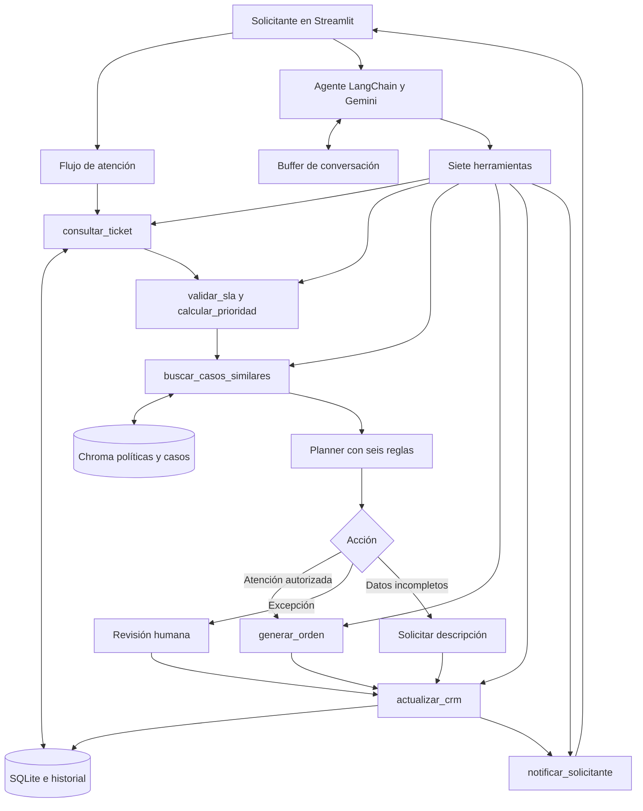
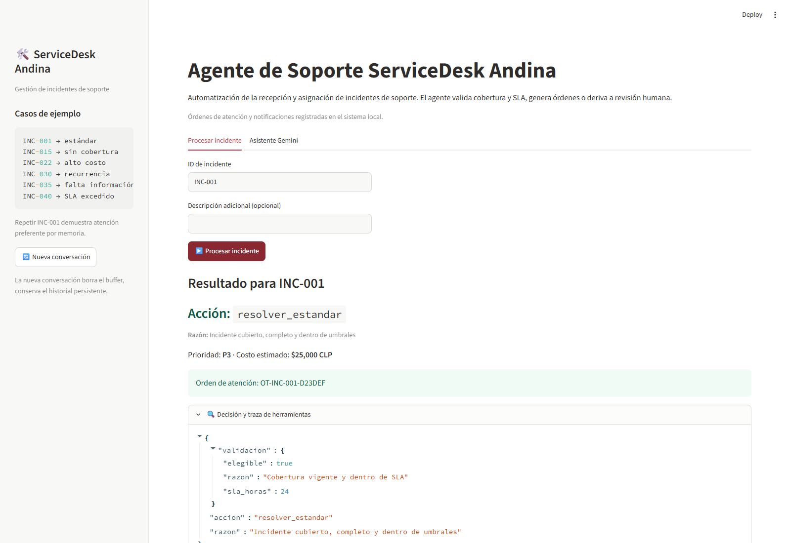

# ServiceDesk Andina

Agente funcional de recepción y asignación de incidentes de soporte empresarial. Consulta tickets, valida cobertura y SLA, calcula prioridad y genera una orden de atención o deriva el caso. Registra decisiones y notificaciones; recupera historial y políticas por significado.

**Integrantes:** Daniela Peña y Mirko Flores. **Asignatura:** Ingeniería de Soluciones con IA, ISY0101, EP2.

## Problema y alcance

ServiceDesk Andina aborda la clasificación de incidentes, la validación de cobertura y el reconocimiento de fallas recurrentes en una mesa de ayuda. El agente automatiza el triage y la asignación. La versión actual almacena órdenes y notificaciones en SQLite; la reparación técnica y el envío externo de comunicaciones quedan fuera de su alcance. El conjunto de prueba contiene 40 incidentes y 15 solicitantes.

## Arquitectura



El flujo estructurado aplica seis reglas deterministas y conserva una traza. El asistente conversacional utiliza LangChain AgentExecutor con Gemini y las mismas siete herramientas. Las escrituras verifican las reglas. Documentación ampliada en [arquitectura](docs/arquitectura.md).

## Herramientas

| Herramienta | Entrada | Resultado y efecto |
|---|---|---|
| consultar_ticket | ticket_id | Incidente, historial y conteo en 90 días |
| validar_sla | ticket_id | Cobertura, cumplimiento y motivo |
| calcular_prioridad | ticket_id | P1, P2 o P3 y tiempo objetivo |
| generar_orden | ticket_id, descripcion opcional | Orden local única; valida reglas antes de escribir |
| actualizar_crm | ticket_id, estado, nota, descripcion | Un evento de decisión; rechaza estados incompatibles |
| notificar_solicitante | solicitante_id, mensaje | Notificación persistida, canal local |
| buscar_casos_similares | texto | Dos políticas y dos casos con fuente y sección |

## Reglas de decisión

| Prioridad | Condición | Acción |
|---|---|---|
| 1 | Cobertura vencida o SLA excedido | escalar |
| 2 | Costo > $100.000 CLP | solicitar_aprobacion |
| 3 | ≥ 3 incidentes en 90 días | escalar_recurrencia |
| 4 | Historial, costo < $50.000 y descripción completa | resolver_preferente |
| 5 | Sin descripción | solicitar_info |
| 6 | Resto de casos cubiertos | resolver_estandar |

El orden es estricto y la primera coincidencia determina la acción. La regla 4 exige información completa para evitar que la preferencia omita datos necesarios. Un escalamiento o una solicitud de aprobación no generan órdenes. P1 identifica impacto empresarial, P2 urgencia alta individual y P3 el resto. El SLA se evalúa con las horas transcurridas registradas en el incidente.

## Instalación desde cero

Se recomienda Python 3.12 de 64 bits y Git. Las dependencias conservan LangChain 0.3 para reproducir las APIs del tutorial. La primera instalación requiere internet y espacio para PyTorch y el modelo de embeddings.

```powershell
git clone https://github.com/Danipez/servicedesk-agent-dpena_mflores.git
cd servicedesk-agent-dpena_mflores
python -m venv .venv
.venv\Scripts\Activate.ps1
python -m pip install -r requirements-lock.txt
Copy-Item .env.example .env
```

En macOS o Linux, sustituir la activación por `source .venv/bin/activate` y la copia por `cp .env.example .env`. Si PowerShell bloquea la activación, usar directamente `.venv\Scripts\python.exe -m ...` o activar desde CMD con `.venv\Scripts\activate.bat`.

Editar `.env` y completar `GOOGLE_API_KEY`; `LLM_MODEL` selecciona el modelo. La clave nunca se agrega al código. El flujo estructurado puede usarse sin Gemini. El modelo requiere cuota en la cuenta; una clave válida no garantiza cuota gratuita.

```powershell
python -m scripts.generate_data
python -m scripts.seed_data
python -m scripts.index_politicas
python -m scripts.verify_llm
python -m pytest tests -v
python -m streamlit run app.py
```

Abrir http://localhost:8501. `seed_data` borra y recrea exclusivamente la base local configurada, incluido su historial; usarlo para reiniciar la demo. `index_politicas` descarga MiniLM la primera vez y construye dos colecciones Chroma. `verify_llm` es una prueba online independiente; si falla por cuota, la interfaz y el flujo estructurado siguen disponibles.

Después de instalar, en Windows también se puede abrir `iniciar.cmd`. El modelo predeterminado es `gemini-3.5-flash-lite`, seleccionado tras verificar disponibilidad y consultas completas. Se utiliza un nombre fijo en lugar del alias `gemini-flash-latest`. `agent/gemini.py` preserva sus firmas de herramientas para conservar compatibilidad con AgentExecutor de LangChain 0.3. La verificación online de dos turnos se ejecuta con `python -m scripts.verify_agent`. Los escenarios con RAG se regeneran con `python -m scripts.demo` sin alterar la base de demostración.

`requirements-lock.txt` fija el entorno validado en Windows y Python 3.12. En otra plataforma, si una dependencia no dispone de distribución compatible, instalar `requirements.txt`, que conserva los rangos del stack, y volver a ejecutar las pruebas. No se afirma validación en otras plataformas.

## Demostración

| Entrada | Resultado inicial esperado |
|---|---|
| INC-001 | resolver_estandar y orden única |
| INC-001 repetido | resolver_preferente; recupera historial |
| INC-015 | escalar por cobertura vencida |
| INC-022 | solicitar_aprobacion por $250.000 |
| INC-030 | escalar_recurrencia |
| INC-035 | solicitar_info |
| INC-040 | escalar por SLA excedido, prioridad P1 |

En la pestaña Asistente Gemini: “Consulta INC-022 y explica qué política impide generar la orden”. La pestaña muestra la respuesta y las herramientas utilizadas. El buffer conserva el contexto para preguntas posteriores.

## Memorias y pruebas

- Corto plazo: ConversationBufferMemory en st.session_state y chat_history en el prompt.
- Largo plazo: SQLite con decisiones, órdenes y notificaciones entre sesiones.
- Semántica: Chroma con seis políticas y cuatro casos, embeddings MiniLM locales y metadatos de fuente.

La suite verifica las seis reglas y límites, herramientas, SQL parametrizado, órdenes bloqueadas e idempotentes, memoria y continuación con información adicional. Cada prueba usa una base temporal independiente; no borra la demo. Evidencia en [pytest_output.txt](evidence/pytest_output.txt) y [resultados de escenarios](evidence/demo_resultados.json).

## Estructura y entrega

`agent/` contiene herramientas, memorias, planner y orquestador; `config/` la configuración; `scripts/` la preparación; `data/` los CSV y políticas; `tests/` las pruebas; `docs/` diagramas, contratos y guion; `evidence/` las verificaciones; `deliverables/` la presentación.

La [presentación de ServiceDesk Andina](deliverables/presentacion_servicedesk_andina.pptx) contiene diez diapositivas editables y notas del expositor para una exposición de 9 minutos y 30 segundos, incluida la demostración. Las notas detallan los tiempos y los casos. Los informes se entregan por separado del código.

Captura del caso estándar:



La verificación desde otra copia del código se describe en [reproducibilidad.md](evidence/reproducibilidad.md).

## Elección de framework

Se recomienda LangChain para mantener fidelidad técnica al tutorial. Haystack también ofrece agentes, herramientas y estado, pero exigiría adaptar esta implementación. La comparación se desarrolla en [comparacion_frameworks.md](docs/comparacion_frameworks.md).

## Referencias

- LangChain. (s. f.). *ChatGoogleGenerativeAI integration*. Recuperado el 6 de noviembre de 2026, de https://docs.langchain.com/oss/python/integrations/chat/google_generative_ai
- LangChain. (s. f.). *Memory overview*. Recuperado el 6 de noviembre de 2026, de https://docs.langchain.com/oss/python/concepts/memory
- deepset. (s. f.). *Agents*. Recuperado el 6 de noviembre de 2026, de https://docs.haystack.deepset.ai/docs/agents
- Google. (s. f.). *Gemini models*. Recuperado el 6 de noviembre de 2026, de https://ai.google.dev/gemini-api/docs/models
- Chroma. (s. f.). *Chroma documentation*. Recuperado el 6 de noviembre de 2026, de https://docs.trychroma.com/
- Sentence Transformers. (s. f.). *all-MiniLM-L6-v2*. Hugging Face. https://huggingface.co/sentence-transformers/all-MiniLM-L6-v2
